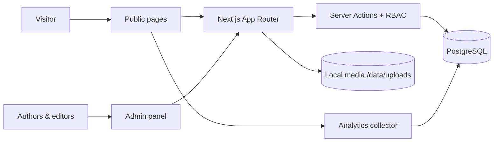

<p align="center">
  <picture>
    <source media="(prefers-color-scheme: dark)" srcset="docs/brands/CMSPlate-logo-dark.png">
    
  </picture>
</p>

<p align="center">
  A bilingual CMS boilerplate with clean writing, measurable SEO,<br>
  first-party analytics, and tidy Docker deploys.
</p>

<p align="center">
  
  
  
  
  
  
</p>

> **Status: v1.0.0, production-ready.** Every first-release feature is complete: two languages, blog, categories, media, SEO monitor, first-party analytics, Google integrations, WhatsApp, users, site settings, and production Docker.

---

## Overview

CMSPlate is a **Next.js-based CMS boilerplate** you can use to build a website. It ships a ready-to-use foundation — admin panel, content editor, SEO, media, and analytics — so you can start building a website without setting up the foundation from scratch.

CMSPlate is an application base for content teams that want to start writing without rebuilding the foundation. The admin panel includes a Tiptap editor, an SEO meter that scores articles before publishing, a media library, and an on-site SEO audit. The public side serves a fast bilingual blog, complete with social metadata, JSON-LD, and `hreflang`.

What sets it apart: analytics runs on your own server without third-party cookies, and every admin surface shares one consistent design system.

---

## Key features

| Area | Capability |
|---|---|
| **Content** | Bilingual articles with revisions, 20-second autosave, scheduled publishing, and a restorable Trash. Hierarchical categories up to three levels deep. |
| **Editor** | Tiptap with headings, lists, quotes, links, images from the media picker, and a character counter. |
| **Media** | Local storage, hashed filenames, automatic WebP variants, required alt/caption for images, and a two-tab picker dialog. |
| **SEO** | 0–100 SEO meter, OpenGraph preview, JSON-LD editor, dynamic `sitemap.xml`, `robots.txt`, and an audit monitor with scores and dismissible issues. |
| **Analytics** | Cookie-free first-party collector, daily visitor hashing, bot filtering, 7/30/90-day dashboard, and cron-driven aggregation and retention. |
| **Integrations** | GTM, GA4, and Google Ads with exclusive mode. Consent Mode v2 defaults to `denied` until the visitor consents. |
| **WhatsApp** | Multiple numbers, selection weights, online schedules per time zone, and single-number or agent-list mode. |
| **System** | Three-role RBAC, user management with last-Super-Admin protection, site settings, light/dark mode, and a fully ID/EN interface. |

---

## Tech stack

| Layer | Choice |
|---|---|
| Framework | Next.js 16.4.3 (App Router, Turbopack) |
| Language | TypeScript strict |
| UI | Tailwind CSS 4.3, shadcn/ui, Radix UI, Lucide |
| Editor | Tiptap 3 |
| Database | PostgreSQL 16 + Prisma 6 |
| Charts | Recharts |
| Testing | Vitest (unit), Playwright (E2E) |
| Deploy | Multi-stage Docker, `/api/health` healthcheck |

---

## Quick start

**Prerequisites:** Node.js ≥ 22, pnpm ≥ 10, and Docker + Docker Compose.

```bash
git clone <repo> cmsplate && cd cmsplate
pnpm install
cp .env.example .env          # adjust the secrets
docker compose up -d db
pnpm prisma migrate dev
pnpm prisma db seed
pnpm dev
```

Open <http://localhost:3000>. The public site is available at `/id` and `/en`. The admin panel lives at `ADMIN_PATH` (default `/admin`), and its login page at `ADMIN_PATH/login`.

### Admin path

`ADMIN_PATH` can be changed via `.env` to reduce automated scanning of the panel. The value is read at runtime, so the container does not need to be rebuilt.

```bash
ADMIN_PATH="my-secret-panel"   # min. 8 characters, lowercase letters and hyphens
```

After changing it, the old `/admin` and `/login` respond with 404. Login moves to `/my-secret-panel/login` as well.

> Changing the path is **not** a replacement for authentication. Pair it with RBAC, rate limiting, and access restrictions at the reverse proxy when needed.

### Seed accounts

| Role | Email | Password |
|---|---|---|
| Super Admin | `admin@simplecms.local` | `Admin123!` |
| Editor | `editor@simplecms.local` | `Admin123!` |
| Author | `author@simplecms.local` | `Admin123!` |

> Change the seed passwords before using them in a real environment. The site name shown in the header can be changed from **Settings**, without touching the package or database name.

---

## Commands

| Command | Purpose |
|---|---|
| `pnpm dev` | Development server |
| `pnpm build` | Generate Prisma Client + production build |
| `pnpm start` | Run the build output |
| `pnpm lint` | ESLint |
| `pnpm typecheck` | TypeScript with no emit |
| `pnpm test` | Unit tests (Vitest) |
| `pnpm test:e2e` | E2E (Playwright, requires a running server) |
| `pnpm prisma migrate dev` | Schema migration during development |
| `pnpm prisma migrate deploy` | Migration in production |
| `pnpm prisma db seed` | Seed data |
| `pnpm prisma studio` | Database inspection |
| `docker compose up --build` | Run the app + database |

### Running E2E

```bash
pnpm build
PORT=3100 pnpm start &
E2E_BASE_URL=http://localhost:3100 pnpm test:e2e
```

Login is limited to 5 attempts per minute per IP. If you run E2E repeatedly within a minute, wait about 60 seconds.

---

## Routes

**Public**

| Route | Purpose |
|---|---|
| `/` | Redirect to the preferred locale (cookie → `Accept-Language` → `id`) |
| `/id`, `/en` | Public home page per language |
| `/id/blog`, `/en/blog` | Article list |
| `/id/blog/[slug]` | Article detail (JSON-LD + `hreflang`) |
| `/id/kategori/[slug]` | Articles by category |
| `/sitemap.xml`, `/robots.txt` | Technical SEO |

**Admin** (paths follow `ADMIN_PATH`; the examples below use `admin`)

| Route | Purpose |
|---|---|
| `/{ADMIN_PATH}/login` | Authentication |
| `/{ADMIN_PATH}` | Dashboard: KPIs, latest articles, SEO summary |
| `/{ADMIN_PATH}/posts` | Article list (status, category, search filters) |
| `/{ADMIN_PATH}/posts/new` | Write an article (Tiptap editor, bilingual) |
| `/{ADMIN_PATH}/posts/[id]/edit` | Edit an article |
| `/{ADMIN_PATH}/posts/trash` | Trash: restore or delete permanently |
| `/{ADMIN_PATH}/categories` | Hierarchical categories |
| `/{ADMIN_PATH}/media` | Media library |
| `/{ADMIN_PATH}/seo` | SEO monitor: audit, issues, filters, dismiss |
| `/{ADMIN_PATH}/analytics` | 7/30/90-day visits |
| `/{ADMIN_PATH}/schema` | Global schema for `Organization`/`WebSite`/`LocalBusiness` |
| `/{ADMIN_PATH}/integrations` | GTM, GA4, Google Ads |
| `/{ADMIN_PATH}/whatsapp` | WhatsApp numbers and button settings |
| `/{ADMIN_PATH}/users` | User management |
| `/{ADMIN_PATH}/settings` | Site identity and publishing preferences |

**API**

| Route | Purpose |
|---|---|
| `/api/analytics/collect` | Page view collector (cookie-free) |
| `/api/media/upload` | Media upload (auth) |
| `/api/media/[...path]` | File serving with immutable cache |
| `/api/cron/analytics` | Daily aggregation + retention (requires `x-cron-secret`) |
| `/api/cron/seo` | Scheduled SEO audit (requires `x-cron-secret`) |
| `/api/health` | Readiness probe |

---

## Architecture



### Project structure

```
app/
  (public)/[locale]/     # home, blog, categories
  admin/                 # admin panel (posts, media, seo, analytics, schema, ...)
  login/                 # authentication
  api/                   # media, analytics, cron, health
  icon.png               # favicon
components/
  admin/                 # shell, sidebar, command palette, forms
  auth/                  # login form
  public/                # header, footer, language switcher, WhatsApp
  ui/                    # shadcn/ui primitives
lib/
  auth/                  # database sessions, password, rate limit
  i18n/                  # id/en dictionaries, message formatting
  seo/                   # schema, audit, queries
  content/slug.ts        # slugify
  db.ts, env.ts, nav.ts, rbac.ts, utils.ts
prisma/
  schema.prisma
  migrations/
  seed.ts
docs/
  PRD.md, PLAN.md, DEPLOY.md, RELEASE.md, design-tokens.css, brands/
public/brand/            # web icons and logos
e2e/                     # Playwright
tests/unit/              # Vitest
proxy.ts                 # locale detection & redirect
```

---

## Technical decisions

- **Database sessions, not JWT.** A random token is stored in an `httpOnly` cookie; the database only stores the SHA-256 of the token.
- **Two languages with prefixes.** `/id` and `/en`, typed dictionaries, `hreflang` and `x-default` per page.
- **A single brand accent.** Terracotta `--primary`; all colors go through tokens in `app/globals.css`.
- **Server Actions** for mutations, with Zod validation and server-side role checks.
- **Soft delete** with a Trash page; permanent deletion is Super Admin only.
- **First-party analytics.** No cookies, daily-hashed IPs, 60/minute rate limit, cron-driven aggregation.
- **Measurable SEO.** The on-site audit stores scores and issues; dismiss actions persist across audits.
- **Global and per-article schema.** JSON-LD templates with `{{site.*}}` and `{{post.*}}` variables resolved on the server.
- **Theme without `next-themes`.** A small `useSyncExternalStore`-based store, with an anti-flash script in the root layout.
- **Local media.** Files live in `UPLOAD_DIR` (default `./data/uploads`) and are served through `/api/media/...`; ready to swap for an S3 adapter.
- **In-memory rate limiting** for login. Suitable for a single Docker instance; use Redis if you scale horizontally.

Full details are in [`docs/PRD.md`](docs/PRD.md) and [`docs/PLAN.md`](docs/PLAN.md).

---

## Security

- Do not commit `.env` or `.env.production`.
- `AUTH_SECRET` and `ANALYTICS_SALT` must be at least 32 random characters: `openssl rand -base64 32`.
- Session cookies are automatically `secure` in production.
- All input is validated on the server before touching the database.
- CSP + HSTS are enabled in production, along with login/upload/analytics rate limiting and path traversal rejection.
- `ADMIN_PATH` hides the panel's location from automated scanning; the old `/admin` and `/login` respond with 404.

---

## Documentation

| Document | Contents |
|---|---|
| [`docs/PRD.md`](docs/PRD.md) | Product requirements, personas, and feature scope |
| [`docs/PLAN.md`](docs/PLAN.md) | Implementation plan and status |
| [`docs/DEPLOY.md`](docs/DEPLOY.md) | Deploy, reverse proxy, cron, backup, upgrade |
| [`docs/RELEASE.md`](docs/RELEASE.md) | Release checklist and smoke test |
| [`CHANGELOG.md`](CHANGELOG.md) | Change history |
| [`docs/brands/`](docs/brands) | Official logo and icons |

---

## License

MIT License. See [`LICENSE`](LICENSE).
