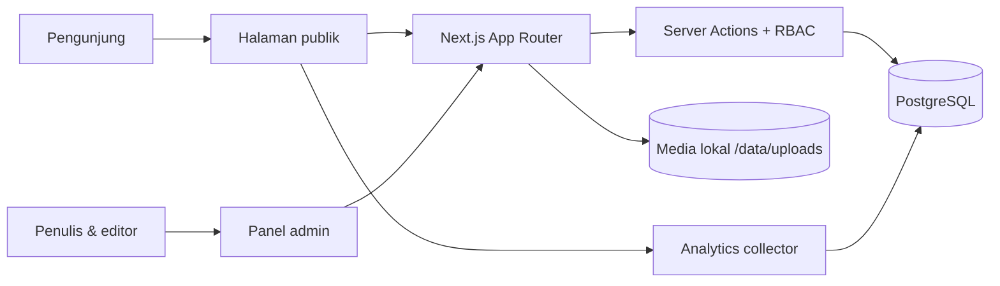

<p align="center">
  <picture>
    <source media="(prefers-color-scheme: dark)" srcset="docs/brands/CMSPlate-logo-dark.png">
    
  </picture>
</p>

<p align="center">
  Boilerplate CMS dua bahasa dengan penulisan yang tenang, SEO yang terukur,<br>
  analytics milik sendiri, dan deploy Docker yang rapi.
</p>

<p align="center">
  
  
  
  
  
  
</p>

> **Status: v1.0.0, siap produksi.** Seluruh fitur rilis pertama sudah selesai: dua bahasa, blog, kategori, media, SEO monitor, analytics first-party, integrasi Google, WhatsApp, pengguna, pengaturan situs, dan Docker produksi.

---

## Ringkasan

CMSPlate adalah **boilerplate CMS berbasis Next.js** yang dapat digunakan untuk membuat sebuah website. Proyek ini menyediakan fondasi siap pakai — mulai dari panel admin, editor konten, SEO, media, hingga analytics — sehingga Anda bisa langsung membangun website tanpa harus menyusun ulang fondasi dari nol.

CMSPlate adalah basis aplikasi untuk tim konten yang ingin langsung menulis tanpa menyusun ulang fondasi. Panel admin memuat editor Tiptap, SEO meter yang menilai artikel sebelum terbit, pustaka media, dan audit SEO on-site. Sisi publik menyajikan blog dua bahasa yang cepat, lengkap dengan metadata sosial, JSON-LD, dan `hreflang`.

Yang membedakannya: analytics berjalan di server sendiri tanpa cookie pihak ketiga, dan seluruh permukaan admin memakai satu design system yang konsisten.

---

## Fitur utama

| Area | Kemampuan |
|---|---|
| **Konten** | Artikel dua bahasa dengan revisi, autosave 20 detik, jadwal terbit, dan Sampah yang bisa dipulihkan. Kategori hierarkis maksimal tiga level. |
| **Editor** | Tiptap dengan heading, list, kutipan, tautan, gambar dari media picker, dan penghitung karakter. |
| **Media** | Penyimpanan lokal, nama file ter-hash, varian WebP otomatis, alt/caption wajib untuk gambar, serta dialog pemilih dua tab. |
| **SEO** | SEO meter 0–100, pratinjau OpenGraph, editor JSON-LD, `sitemap.xml` dinamis, `robots.txt`, dan monitor audit dengan skor serta isu yang bisa diabaikan. |
| **Analytics** | Collector first-party tanpa cookie, hash pengunjung harian, filter bot, dashboard 7/30/90 hari, agregasi dan retensi lewat cron. |
| **Integrasi** | GTM, GA4, dan Google Ads dengan mode eksklusif. Consent Mode v2 default `denied` sampai pengunjung setuju. |
| **WhatsApp** | Banyak nomor, bobot pilih, jadwal online per zona waktu, mode nomor tunggal atau daftar agen. |
| **Sistem** | RBAC tiga peran, manajemen pengguna dengan proteksi Super Admin terakhir, pengaturan situs, mode terang/gelap, dan antarmuka penuh ID/EN. |

---

## Tumpukan teknologi

| Lapisan | Pilihan |
|---|---|
| Framework | Next.js 16.4.3 (App Router, Turbopack) |
| Bahasa | TypeScript strict |
| UI | Tailwind CSS 4.3, shadcn/ui, Radix UI, Lucide |
| Editor | Tiptap 3 |
| Database | PostgreSQL 16 + Prisma 6 |
| Grafik | Recharts |
| Test | Vitest (unit), Playwright (E2E) |
| Deploy | Docker multi-stage, healthcheck `/api/health` |

---

## Mulai cepat

**Prasyarat:** Node.js ≥ 22, pnpm ≥ 10, dan Docker + Docker Compose.

```bash
git clone <repo> cmsplate && cd cmsplate
pnpm install
cp .env.example .env          # sesuaikan secret
docker compose up -d db
pnpm prisma migrate dev
pnpm prisma db seed
pnpm dev
```

Buka <http://localhost:3000>. Situs publik tersedia di `/id` dan `/en`. Panel admin berada di `ADMIN_PATH` (default `/admin`), dan halaman masuknya di `ADMIN_PATH/login`.

### Path admin

`ADMIN_PATH` dapat diubah lewat `.env` untuk mengurangi pemindaian otomatis terhadap panel. Nilainya dibaca saat runtime, jadi container tidak perlu di-build ulang.

```bash
ADMIN_PATH="panel-rahasia-saya"   # min. 8 karakter, huruf kecil dan tanda hubung
```

Setelah diganti, `/admin` dan `/login` lama akan membalas 404. Login ikut pindah ke `/panel-rahasia-saya/login`.

> Mengganti path **bukan** pengganti autentikasi. Gunakan bersama RBAC, rate limit, dan pembatasan akses di reverse proxy bila perlu.

### Akun seed

| Peran | Email | Password |
|---|---|---|
| Super Admin | `admin@simplecms.local` | `Admin123!` |
| Editor | `editor@simplecms.local` | `Admin123!` |
| Author | `author@simplecms.local` | `Admin123!` |

> Ganti password seed sebelum dipakai di lingkungan nyata. Nama situs yang tampil di header dapat diubah lewat **Pengaturan**, tanpa mengubah nama paket atau database.

---

## Perintah

| Perintah | Fungsi |
|---|---|
| `pnpm dev` | Server pengembangan |
| `pnpm build` | Generate Prisma Client + build produksi |
| `pnpm start` | Jalankan hasil build |
| `pnpm lint` | ESLint |
| `pnpm typecheck` | TypeScript tanpa emit |
| `pnpm test` | Unit test (Vitest) |
| `pnpm test:e2e` | E2E (Playwright, butuh server berjalan) |
| `pnpm prisma migrate dev` | Migrasi skema saat pengembangan |
| `pnpm prisma migrate deploy` | Migrasi di produksi |
| `pnpm prisma db seed` | Data awal |
| `pnpm prisma studio` | Inspeksi database |
| `docker compose up --build` | Jalankan app + database |

### Menjalankan E2E

```bash
pnpm build
PORT=3100 pnpm start &
E2E_BASE_URL=http://localhost:3100 pnpm test:e2e
```

Login dibatasi 5 percobaan per menit per IP. Jika E2E dijalankan berulang dalam satu menit, tunggu ±60 detik.

---

## Rute

**Publik**

| Rute | Fungsi |
|---|---|
| `/` | Redirect ke locale pilihan (cookie → `Accept-Language` → `id`) |
| `/id`, `/en` | Beranda publik per bahasa |
| `/id/blog`, `/en/blog` | Daftar artikel |
| `/id/blog/[slug]` | Detail artikel (JSON-LD + `hreflang`) |
| `/id/kategori/[slug]` | Artikel per kategori |
| `/sitemap.xml`, `/robots.txt` | SEO teknis |

**Admin** (path mengikuti `ADMIN_PATH`, contoh di bawah memakai `admin`)

| Rute | Fungsi |
|---|---|
| `/{ADMIN_PATH}/login` | Autentikasi |
| `/{ADMIN_PATH}` | Dashboard: KPI, artikel terbaru, ringkasan SEO |
| `/{ADMIN_PATH}/posts` | Daftar artikel (filter status, kategori, pencarian) |
| `/{ADMIN_PATH}/posts/new` | Tulis artikel (editor Tiptap, dua bahasa) |
| `/{ADMIN_PATH}/posts/[id]/edit` | Edit artikel |
| `/{ADMIN_PATH}/posts/trash` | Sampah: pulihkan atau hapus permanen |
| `/{ADMIN_PATH}/categories` | Kategori hierarkis |
| `/{ADMIN_PATH}/media` | Pustaka media |
| `/{ADMIN_PATH}/seo` | SEO monitor: audit, isu, filter, abaikan |
| `/{ADMIN_PATH}/analytics` | Kunjungan 7/30/90 hari |
| `/{ADMIN_PATH}/schema` | Schema global `Organization`/`WebSite`/`LocalBusiness` |
| `/{ADMIN_PATH}/integrations` | GTM, GA4, Google Ads |
| `/{ADMIN_PATH}/whatsapp` | Nomor dan pengaturan tombol WhatsApp |
| `/{ADMIN_PATH}/users` | Manajemen pengguna |
| `/{ADMIN_PATH}/settings` | Identitas situs dan preferensi publikasi |

**API**

| Rute | Fungsi |
|---|---|
| `/api/analytics/collect` | Collector page view (tanpa cookie) |
| `/api/media/upload` | Upload media (auth) |
| `/api/media/[...path]` | Penyajian file dengan cache immutable |
| `/api/cron/analytics` | Agregasi harian + retensi (butuh `x-cron-secret`) |
| `/api/cron/seo` | Audit SEO terjadwal (butuh `x-cron-secret`) |
| `/api/health` | Readiness probe |

---

## Arsitektur



### Struktur proyek

```
app/
  (public)/[locale]/     # beranda, blog, kategori
  admin/                 # panel admin (posts, media, seo, analytics, schema, ...)
  login/                 # autentikasi
  api/                   # media, analytics, cron, health
  icon.png               # favicon
components/
  admin/                 # shell, sidebar, command palette, form
  auth/                  # formulir login
  public/                # header, footer, pemilih bahasa, WhatsApp
  ui/                    # primitif shadcn/ui
lib/
  auth/                  # sesi database, password, rate limit
  i18n/                  # kamus id/en, format pesan
  seo/                   # schema, audit, query
  content/slug.ts        # slugify
  db.ts, env.ts, nav.ts, rbac.ts, utils.ts
prisma/
  schema.prisma
  migrations/
  seed.ts
docs/
  PRD.md, PLAN.md, DEPLOY.md, RELEASE.md, design-tokens.css, brands/
public/brand/            # ikon dan logo web
e2e/                     # Playwright
tests/unit/              # Vitest
proxy.ts                 # deteksi & redirect locale
```

---

## Keputusan teknis

- **Sesi database, bukan JWT.** Token acak disimpan di cookie `httpOnly`; database hanya menyimpan SHA-256 dari token.
- **Dua bahasa dengan prefiks.** `/id` dan `/en`, kamus bertipe, `hreflang` dan `x-default` per halaman.
- **Satu aksen brand.** Terakota `--primary`; semua warna lewat token di `app/globals.css`.
- **Server Actions** untuk mutasi, dengan validasi Zod dan pemeriksaan peran di server.
- **Soft delete** dengan halaman Sampah; hapus permanen khusus Super Admin.
- **Analytics first-party.** Tanpa cookie, IP di-hash harian, rate limit 60/menit, agregasi lewat cron.
- **SEO terukur.** Audit on-site menyimpan skor dan isu; aksi abaikan bertahan antar audit.
- **Schema global dan per artikel.** Template JSON-LD dengan variabel `{{site.*}}` dan `{{post.*}}` di-resolve di server.
- **Tema tanpa `next-themes`.** Store kecil berbasis `useSyncExternalStore`, dengan script anti-flash di root layout.
- **Media lokal.** File di `UPLOAD_DIR` (default `./data/uploads`), disajikan lewat `/api/media/...`; siap diganti adapter S3.
- **Rate limit in-memory** untuk login. Cocok untuk satu instance Docker; gunakan Redis bila di-scale horizontal.

Detail lengkap ada di [`docs/PRD.md`](docs/PRD.md) dan [`docs/PLAN.md`](docs/PLAN.md).

---

## Keamanan

- Jangan commit `.env` atau `.env.production`.
- `AUTH_SECRET` dan `ANALYTICS_SALT` minimal 32 karakter acak: `openssl rand -base64 32`.
- Cookie sesi otomatis `secure` di produksi.
- Semua input divalidasi di server sebelum menyentuh database.
- CSP + HSTS aktif di produksi, bersama rate limit login/upload/analytics dan penolakan path traversal.
- `ADMIN_PATH` menyembunyikan lokasi panel dari pemindaian otomatis; `/admin` dan `/login` lama membalas 404.

---

## Dokumentasi

| Dokumen | Isi |
|---|---|
| [`docs/PRD.md`](docs/PRD.md) | Kebutuhan produk, persona, dan cakupan fitur |
| [`docs/PLAN.md`](docs/PLAN.md) | Rencana implementasi dan status |
| [`docs/DEPLOY.md`](docs/DEPLOY.md) | Deploy, reverse proxy, cron, backup, upgrade |
| [`docs/RELEASE.md`](docs/RELEASE.md) | Checklist rilis dan smoke test |
| [`CHANGELOG.md`](CHANGELOG.md) | Riwayat perubahan |
| [`docs/brands/`](docs/brands) | Logo dan ikon resmi |

---

## Lisensi

Internal. Tidak untuk distribusi publik tanpa persetujuan. Lihat [`LICENSE`](LICENSE).
